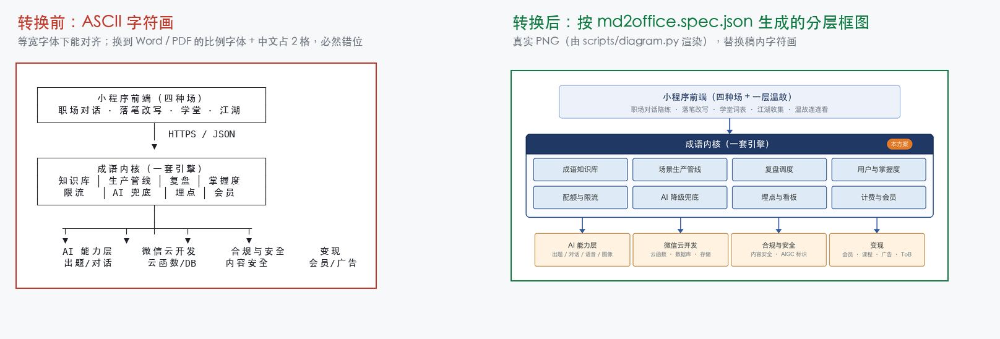

# md-to-office —— Markdown → Word / PDF 工具库

<sub>中文 · <a href="README.en.md">English</a></sub>

把 Markdown 转成排版规范的中文 **Word（.docx）** 与／或 **PDF**，可选地生成**分层架构图**并把稿内的 **ASCII 字符画自动替换**成真正的图。



<sub>左边是稿子里的样子（等宽字体下能对齐），右边是转换后的**真实 PNG**（由 `scripts/diagram.py` 按 `md2office.spec.json` 渲染）。`python3 tools/make_before_after.py` 可重新生成这张图。</sub>

两种用法：**当命令行工具直接用**，或**作为 Agent Skill 安装**（Claude Code / Codex / DSH 等），让 AI 自动调用。写方案、出报告、做交付物都适用。

> 只出 Word 时**不需要任何外部二进制**，只依赖 `python-docx` 与 `Pillow`。

## 一行装好

```bash
git clone https://github.com/darkknight110/md-to-office.git ~/.md-to-office \
  && python3 -m pip install -q -r ~/.md-to-office/requirements.txt \
  && python3 ~/.md-to-office/scripts/md2office.py --help
```

装完就能用：`python3 ~/.md-to-office/scripts/md2office.py --input ./文档 --output ./导出 --format docx`。
不想装依赖也可以先 `--help` 看一下；只出 Word 时依赖仅 `python-docx` + `Pillow`。

> **排版有据可依**：正文 10.5pt / 1.15 倍行距 / 22-22-20-20mm 不是拍脑袋——
> 52 份真实交付物的实测值与国标公文的差距都在 [docs/typography-baseline.md](docs/typography-baseline.md)（机器可读：[typography-baseline.json](docs/typography-baseline.json)）。

---

## 为什么需要它

Markdown 里的架构图通常是用字符画的：

```
┌──────────────────────────┐
│      园区运营平台         │
└───────────┬──────────────┘
```

它在编辑器里能看，**但转成 Word/PDF 后必然错位**——因为字符画靠等宽字体逐字符对齐，而 Word 会用比例字体，中文字符还占 2 格。本工具库的解法是：**不再用字符画，改成生成真正的分层框图**。

---

## 快速开始

```bash
PY="python3"                    # 或你的虚拟环境解释器
SK="<本仓库>/scripts"

# 两者都出
"$PY" "$SK/md2office.py" --input ./文档 --output ./导出 --format both

# 只出 Word
"$PY" "$SK/md2office.py" --input ./文档 --output ./导出 --format docx

# 只出 PDF
"$PY" "$SK/md2office.py" --input ./文档 --output ./导出 --format pdf

# 只转部分文件
"$PY" "$SK/md2office.py" --input ./文档 --output ./导出 --format pdf --only "07_*.md"

# 单个文件
"$PY" "$SK/md2office.py" --input ./方案.md --output ./导出 --format docx
```

`--input` 是目录时会**递归**找 `*.md`，并在输出目录里保持相对结构。

---

## 参数

### md2office.py（统一入口）

| 参数 | 说明 | 默认 |
|---|---|---|
| `--input` | `.md` 文件或目录 | 必填 |
| `--output` | 输出目录 | 必填 |
| `--format` | `docx` / `pdf` / `both` | `both` |
| `--only` | 文件名通配，可重复 | 全部 |
| `--spec` | 规格 JSON（架构图 + 替换规则） | 自动找 `md2office.spec.json` |
| `--no-prep` | 跳过预处理 | 否 |
| `--keep-intermediate` | `pdf` 模式保留中间 `.docx` | 否 |
| `--keep-prepared` | 保留预处理后的 md（便于排查） | 否 |
| `--font-body` | 正文中文字体 | `宋体` |
| `--font-heading` | 标题中文字体 | `微软雅黑` |
| `--font-code` | 代码字体 | `Consolas` |
| `--size-body` | 正文字号 pt | `10.5` |
| `--size-table` | 表格字号 pt | `9` |
| `--page` | `a4` / `letter` | `a4` |
| `--no-footer` | 不输出页码 | — |

### md2docx.py（转换引擎）

可单独用，也可作为库 import：

```bash
"$PY" "$SK/md2docx.py" --input in.md --output out.docx --font-body 思源宋体 --page letter
```

```python
from md2docx import Config, convert
convert("in.md", "out.docx", Config(body_ea="思源宋体", body_size=11))
```

### diagram.py（架构图）

```bash
"$PY" "$SK/diagram.py" --spec spec.json --out-dir ./导出
```

---

## 架构图规格

在**被转换目录**下建 `md2office.spec.json`（或用 `--spec` 指定）：

```json
{
  "diagrams": [
    {
      "out": "diagrams/arch.png",
      "top":   { "title": "顶层平台", "sub": "副标题" },
      "main":  { "title": "核心系统", "badge": "本方案",
                 "modules": [["模块1","模块2","模块3"], ["模块4","模块5","模块6"]] },
      "bottoms": [ { "title": "对接对象A", "sub": "说明" },
                   { "title": "对接对象B" } ]
    }
  ],
  "blocks": [
    { "contains": ["顶层平台", "核心系统"], "image": "diagrams/arch.png" }
  ],
  "defence_numbered_blocks": true
}
```

| 字段 | 作用 |
|---|---|
| `diagrams[]` | 要生成的架构图；`modules` 是二维数组，每个子数组是主体层的一行 |
| `diagrams[].tool` | 渲染后端。省略 = 内置 Pillow 渲染器（**零外部依赖**）；`"archify"` = 交给 archify（需另装，见下） |
| `blocks[]` | 代码块 → 图片的替换规则；`contains` 里的关键词**全部命中**才替换，**没命中就保留原样**（不误替换） |
| `defence_numbered_blocks` | 把代码块里的编号流程（1. 2. 3.）去围栏，变成正常的编号列表 |

生成的图存在 `<输出目录>/<out>`，预处理时以绝对路径插入文档。

> **替换的前提**：`blocks[]` 规则只对**含制表符画线（`┌─┐│└┘` 等）的代码块**生效。
> 普通代码块即使关键词命中也不会被替换——这是刻意的，避免误替换真代码。

---

## 可选：用 archify 渲染复杂图

内置 `diagram.py` 只画「顶层平台 → 主体 → 对接对象」这种**分层框图**。遇到时序图、ER 图、
数据流、状态机这类图，可以交给 [archify](https://github.com/tt-a1i/archify)（10 种图型，
自带真实浏览器校验，输出可交互 HTML）。

**这是可选依赖**，不装不影响内置渲染器。

指定 `"tool": "archify"`，把 archify 的 JSON-IR 放进 `archify` 字段：

```json
{
  "diagrams": [
    {
      "out": "diagrams/flow.png",
      "tool": "archify",
      "archify": {
        "schema_version": 2,
        "diagram_type": "workflow",
        "meta": { "title": "订单处理流程", "locale": "zh", "output": "x.html" },
        "lanes": [ { "id": "customer", "label": "顾客" }, { "id": "platform", "label": "平台" } ],
        "nodes": [
          { "id": "order", "lane": "customer", "col": 0, "type": "external", "label": "下单" },
          { "id": "pay",   "lane": "platform", "col": 1, "type": "backend",  "label": "支付" }
        ],
        "edges": [ { "id": "e1", "from": "order", "to": "pay", "label": "确认" } ]
      }
    }
  ]
}
```

`meta.output` 会被自动改写（archify 要求它是相对路径），无需手填有意义的值。

可选字段：`"quality": "standard" | "showcase"`（默认 `showcase`）。

定位顺序：`ARCHIFY_BIN` 环境变量 → PATH 上的 `archify` → `~/.dsh/skills/archify/`
`~/.claude/skills/archify/` 等常见技能目录。安装：

```bash
npx skills add tt-a1i/archify -g
```

也可单独跑：`python scripts/archify_bridge.py --spec archify.json --out diagrams/x.png`

---

## 支持的 Markdown 语法

✅ 标题 1–4 级 · 表格（**表头跨页重复**、**行不跨页断开**）· 无序／有序列表 · 引用块 · 代码块 · 独占一行的图片 · `**粗体**` · `` `行内代码` `` · `[链接](url)` · `---` 分隔线

❌ **不支持**：嵌套列表的多级样式、粗斜体叠加、单元格内转义竖线 `\|`、目录（TOC）自动生成、页眉、脚注、公式、HTML 标签

表格列宽是**等分**的；列多、文本长时会被挤（可接受，但不完美）。

---

## 已知限制

1. **PDF 只能从 DOCX 转**。链路必然是 `Markdown → DOCX → PDF`——环境里没有 pandoc，LibreOffice 也不认 Markdown。`--format pdf` 会在临时目录生成 DOCX，转完只保留 PDF。
2. **PDF 需要任一个 LibreOffice 后端**，按以下顺序自动选择：

   | 顺序 | 后端 | 触发条件 |
   |---|---|---|
   | 1 | 系统 LibreOffice | `LIBREOFFICE_PATH` / `SOFFICE_PATH` 指向 `soffice`，或 PATH 上有 `soffice` / `libreoffice`，或装在常见路径（macOS `/Applications/LibreOffice.app`、Linux `/usr/bin`、Windows `C:\Program Files\LibreOffice`） |
   | 2 | DSH 随附 libreoffice-kit | 自动探测，或由 `LIBREOFFICE_KIT_NODE` + `LIBREOFFICE_KIT_CLI` 指定 |

   两个都没有时会报错，并同时列出这两条路——**只出 Word 请用 `--format docx`，完全不需要 PDF 后端**。
3. **字体缺失会触发替换**。生成 PDF 的机器若没有 `宋体`／`微软雅黑`／`Consolas`，PDF 会用替代字体渲染（中文正常，字形略有差异）。要在 Word 里效果一致，需在渲染机安装对应字体。
4. **`--font-*` 只改字体名**，能否命中取决于渲染机装没装。
5. **本仓库不分发任何字体**。架构图渲染需要**中文字体**，否则会明确报错（不静默产出豆腐块图）：
   - macOS / Windows 通常自带中文字体，开箱可用；
   - 最小化 Linux 镜像需要装：`apt-get install -y fonts-noto-cjk`；
   - 或用 `--font <路径>` 指定一个 `.ttf/.ttc`。
   单测在没有中文字体的机器上会**跳过**架构图相关用例（而不是伪装通过），CI 里则先装字体验证全量。

---

## 目录结构

```
md-to-office/
├── SKILL.md                         技能定义（作为 Agent Skill 安装时用）
├── README.md                        本文件
├── README.en.md                     英文版（What / Why / API / Limits）
├── LICENSE                          标准 MIT（未修改，便于 GitHub 自动识别）
├── NOTICE.md                        来源/作者身份、第三方依赖与字体声明
├── requirements.txt                 python-docx / Pillow
├── .gitignore
├── scripts/
│   ├── md2office.py                 统一入口（格式选择、批量、PDF 后端调度）
│   ├── md2docx.py                   转换引擎（可 import）
│   ├── diagram.py                   架构图生成（内置 Pillow 渲染器）
│   ├── archify_bridge.py            可选：调用 archify 渲染复杂图型
│   ├── gongwen.py                   公文模板引擎（template add/show → render → check）
│   └── spec.example.json            规格示例
├── tools/
│   ├── measure_typography.py        排版量测（PDF/DOCX → JSON，基线可复跑）
│   └── make_before_after.py         生成 docs/before-after.png（视觉证据可复跑）
├── docs/
│   ├── typography-baseline.md       排版基线：52 份实测 vs GB/T 9704-2012
│   ├── typography-baseline.json     机器可读基线（profiles / gaps / limits）
│   ├── gongwen.md                   公文模板：用法与边界
│   ├── gongwen-review.md            公文模板：复核记录（实测数字 + 已知限制）
│   └── before-after.png             转换前后对比图
├── examples/
│   ├── demo/sample.md               冒烟用样例（CI 真实转换）
│   └── gongwen/make_blank_template.py  生成空白公文模板（无红头、无单位信息）
└── tests/
    ├── test_smoke.py                冒烟测试（stdlib unittest）
    └── test_gongwen.py              公文模板引擎测试
```

---

## 安装

### 方式一：命令行工具（任何项目）

```bash
git clone <本仓库> md-to-office
cd md-to-office
python3 -m venv .venv && .venv/bin/pip install -r requirements.txt
.venv/bin/python scripts/md2office.py --input ./文档 --output ./导出 --format docx
```

PDF 需要额外装 LibreOffice（见「已知限制」第 2 条）。

### 方式二：作为 Agent Skill

把整个目录放进 agent 扫描的技能根目录即可，无需重启（技能目录会在下一个模型步骤刷新）：

| Rank | 路径 |
|---|---|
| 100 | `<项目根>/.dsh/skills/` |
| 200 | `<项目根>/.agents/skills/` |
| 400 | `~/.dsh/skills/` ← 全局推荐 |
| 500 | `~/.agents/skills/` |
| — | `~/.claude/skills/`（Claude Code） |

## 测试

```bash
python3 -m unittest discover -s tests -v     # 25 例：13 冒烟 + 12 公文模板
```

## 公文模板（L2：模板固化）

**它不是"生成公文"，是"按你的模板填内容"**：版心/字号/行距/页码/红头/版记/印章位都由模板带来。

```bash
python3 scripts/gongwen.py template add 某单位模板.docx --name 某单位
python3 scripts/gongwen.py template show 某单位
python3 scripts/gongwen.py render --template 某单位 --data data.json --body 正文.md --out 成文.docx
python3 scripts/gongwen.py check 成文.docx --template 某单位
```

- 生成时校验模板 sha256（换过就拒绝）、缺失占位符就拒绝、产物自动量一遍（边距/字号/行距/缩进）；
- **不生成红头、版记、印章**；印章只留位置；
- 用法与边界：[docs/gongwen.md](docs/gongwen.md)；复核记录（含两个被修掉的缺陷）：[docs/gongwen-review.md](docs/gongwen-review.md)。

## 校验（可选）

若装了 `office-docx` 技能，可用它校验生成的 DOCX 结构；**没有这个技能不影响本工具运行**：

```bash
"$PY" "<office-docx 技能的 scripts>/check_office.py" out.docx --out checks.json
```

---

## 来源说明

本项目代码由 **AI 编码助手（DeepSeek v4.1 flash）在维护者提供的本项目具体场景下生成**，
维护者负责需求定义、上下文提供、审阅、修改与验证。它**不是从任何既有开源项目复制的**。

旁证：代码高度贴合本项目场景，而非通用库形态——默认字体直接取中文商务文档的
`宋体`/`微软雅黑`/`Consolas`（`md2docx.py:38-40`），字符画识别用一组特化的制表符集合
`BOX_CHARS`（`md2office.py:43`），还有为答辩场景设计的 `defence_numbered_blocks`
（`md2office.py:177`）。全部 import 仅标准库 + `python-docx` + `Pillow`，没有搬运任何模块结构。

关于 AI 生成内容的著作权状况、第三方依赖与字体声明，见 [NOTICE.md](NOTICE.md)。
无论著作权状况如何，[MIT](LICENSE) 授予你的使用、修改、分发权利完整有效。

